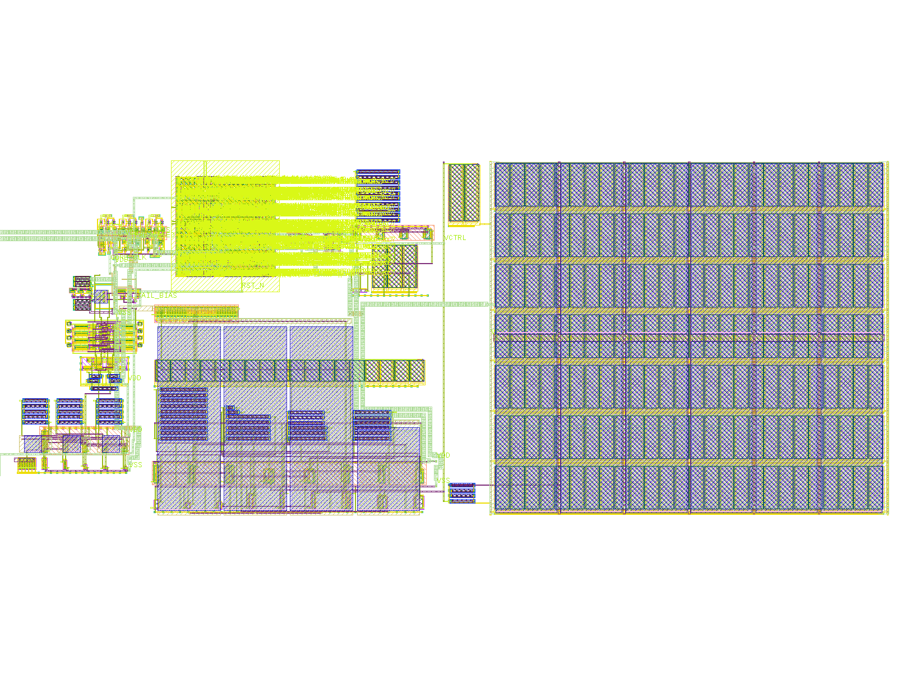
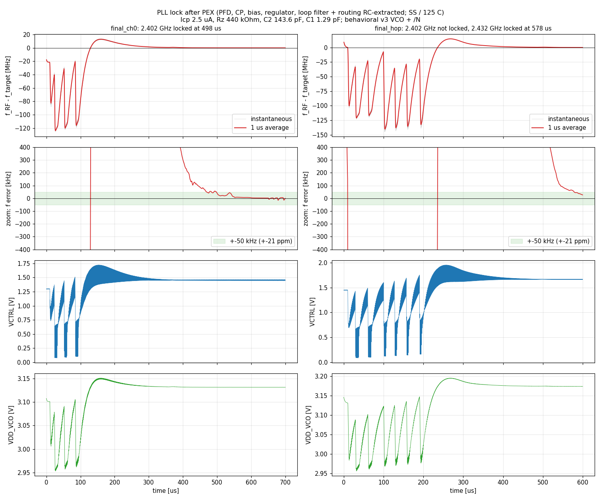

# PLL_COMPACT: integrated BLE PLL / TX layout (GF180MCU, 6-metal E stack)

The GDS is `gds/PLL_COMPACT.gds` (top cell `PLL_COMPACT`). It integrates:

- the v3 VCO (symmetric core + Gilbert XOR doubler, Schottky path kept);
- the PA-side converter + drivers + 50 µm PA device;
- the A01 prescaler, divider, PFD and charge pump;
- the 3.3 V VCO supply regulator from `/foss/designs/vco_supply_regulator_3v3`, now laid out;
- the A01 loop filter, rebuilt in stacked form;
- a new on-chip bias block (2.5 µA into the CP IBIAS, retuned from 20 µA for loop stability, and about 1.7 V on TAIL_BIAS);
- the `ble_tx_uart` digital block.

The source GDS files of the user and the A01 repository are only read, never modified.




## Files in this folder

This folder replaces the first PLL integration (`A01_topcell`, commit f8b50d8, still in the history).

| Path | Contents |
|---|---|
| `gds/` | `PLL_COMPACT.gds` (self-contained top) and the new cells `VCO_REG_L`, `PLL_LF_L`, `RF_CONV_PA`, `PLL_BIAS` |
| `spice/` | LVS reference used by the root `lvs_config.json`: `PLL_COMPACT_lvs.spice` (top) and `macros/*.spice`, one per GDS macro cell |
| `layout/` | Build, route and check scripts (`build_*.py`, `route_top.py`, `lvs_top.py`, `conncheck.py`, `tapcheck.py`, `extract_rf.py`, `gen_lvs_ref.py`) and the new cells' netlists |
| `macros/vco_xor/` | Source GDS and LVS netlist of the v3 VCO + XOR (not elsewhere in the repo) |
| `verification/` | Top DRC report (78, all inherited OFFGRID/DF.9 from the v3 VCO), full-chip LVS report, LVS of the `lvs_config.json` reference |
| `pex/` | RC extraction of the loop partition (PFD, CP, bias, regulator, loop filter + routing) |
| `sim/` | Post-PEX lock testbench and plots (`sim/lock/`), loop retune and PFD characterisation (`sim/retune/`) |
| `bias_study/`, `reg_study/` | Bias and regulator sizing studies |
| `assemble_layout.py`, `design.py`, `tech/` | Kept from the A01 flow: `route_top.py` imports its `Router`, and the extraction uses the six-metal tech |

The scripts were run in the IIC-OSIC-TOOLS container and use absolute paths: this repository at
`/foss/designs/pll_integration_repo`, the design folder at `/foss/designs/pll_compact` (= this `build/` folder's
`layout/`, `sim/`, ... ) and the VCO at `/foss/designs/Diff_VCO_Second_Layout/vco_xor_layout` (= `macros/vco_xor/`).

**LVS:** the root `lvs_config.json` compares `build/gds/PLL_COMPACT.gds` against `build/spice/`. That reference was
checked with netgen against the full-chip extraction: 22,912 devices and 12,530 nets, circuits match uniquely
(`verification/PLL_COMPACT_lvs_config_ref.report`). The digital (`ble_tx_uart`, `ble_feedback_divider`) and A01
analog macro references are extractions of their own signed-off GDS.

## Floorplan and the short links

Coordinates are in µm, with the VCO at the origin.

| Block | Place | Size |
|---|---|---|
| v3 VCO + XOR | origin | 38 × 60 |
| 32/33 prescaler (mirrored in y) | directly on top of the VCO | 33 × 22 |
| integer-N divider (mirrored in x) | right of the prescaler | 52 × 63 |
| PFD (mirrored) + charge pump | right of the divider | 13 × 8, 9 × 11 |
| PLL_BIAS (new) | right of the charge pump | 40 × 61 |
| VCO_REG_L (new) | right of the VCO, under the divider | 138 × 101 |
| PLL_LF_L (new, 143.6 pF + 440 kΩ + 1.29 pF) | right of the regulator | 213 × 170 |
| RF_CONV_PA (new) | under the VCO (mirrored, PA end west) | 55 × 37 |
| ble_tx_uart | 30 µm left of the loop | 270 × 300 |

The PLL loop occupies about 395 × 170 µm. The A01 filter capacitor alone took eight 117 × 104 µm tiles.

| Link | Route length |
|---|---|
| CORE_CLK (VCO → prescaler, 1.2 GHz) | about 12 µm on MetalTop, through an M5 opening in the prescaler |
| MC (divider → prescaler) | 27 µm M4 |
| FB_1M (divider → PFD) | 4 µm M3 |
| XP / XN (XOR → converter) | 3 µm / 15 µm |
| UPB / DN (PFD → CP) | 27 / 22 µm |
| CP_IBIAS (bias → CP) | 17 µm |
| VCTRL (CP → filter riser → regulator) | 53 µm + filter riser + 3.6 µm jumper |
| VDD_VCO (regulator VOUT → VCO core landing) | 16 µm M5, 2.2 µm wide |
| PRESCALED (prescaler → divider) | 91 µm |
| TAIL_BIAS (bias → VCO buffer) | 122 µm (DC, 1.4 pF decoupled at the bias end) |
| RST_N (divider → digital) | 205 µm (static) |

## New cells

All cells are DRC 0 and LVS "Circuits match uniquely":

- **VCO_REG_L:** the schematic regulator.
  - The resistors are ppolyf_u_1k meanders with the nominal values.
  - Ccomp and Cbuf are MIM combs whose fingers are no wider than 28.7 µm.
  - The pass device is 192 µm wide and drives an M5 VOUT bus.
  - VIN reaches the pass device through 23 two-cut M2→MT stacks on its source strips, a 4.2 µm MT strap over the device and a 5.6 µm MT bus down the east edge; the top-level VDD lands on that bus. The first layout fed the 2 mA through router-width M3/M4 tracks: post-PEX that dropped 101 mV and capped VDD_VCO at 3.13 V (SS/125). Now the drop is 4 mV and the post-PEX ceiling is 3.226 V (schematic 3.234 V).
  - 4.3 pF of MOS decap sits under the MIM.
  - The 470 pF test-bench output cap is not needed. Load steps show no ringing with Cout = 20 pF–470 pF at SS/TT/FF (`reg_study/step.py`), because the Miller compensation sets the margin.
  - VCTRL → VDD_VCO is 0.2 V/V with −3 dB at 39 kHz (SS/125) and 84 kHz (TT) (`reg_study/ac.py`).
- **PLL_LF_L:** C2 has 54.8 pF of MIM (12 plates of 28.2 × 80.6 µm) plus 88.7 pF of cap_nmos_03v3 underneath, at 1.6 V. Rz is 440 kΩ: 28 × 15.08 µm of ppolyf_u_1k in the side strip (439 kΩ TT, 489 kΩ SS/125). C1 is two MOS-cap units (1.29 pF).
- **PLL_BIAS:** a resistor-referenced PMOS mirror.
  - Reference: VDD → PMOS diode (4/2) → Rref (10 × 18.6 µm HR poly) gives about 10 µA.
  - A ×¼ mirror (1.04/2 µm, same L as the diode) sources 2.5 µA into the CP IBIAS diode. The A01 charge pump mirrors IBIAS 1:1, so Icp = 2.5 µA.
  - A ×1 mirror feeds a 1.0/5.6 µm NMOS diode, which sets TAIL_BIAS. It has 1.4 pF of decap.
  - The block draws about 23 µA (plus the VCO buffer tail it biases).
- **RF_CONV_PA:** the converter variant E chain (the best of E/X/A in `conv_study`): coupling MIM, self-biased 1/2 inverter, second coupling MIM, self-biased 2/4, then 4/8 and 10/20 drivers and the 50/0.28 µm PA device (nf = 10).

Bias block at TT/27 °C/3.3 V: **I_CP = 2.50 µA, TAIL_BIAS = 1.69 V** (`bias_study/bias3.py`; the original 20 µA version is `bias2.py`). Over corners:

| Quantity | Spread |
|---|---|
| I_CP | 1.86–3.42 µA (0.74×–1.37×) |
| TAIL_BIAS | 1.55–1.91 V |
| VCO buffer tail current | 115–197 µA (101–211 µA with a fixed 1.7 V) |

A constant-gm (beta-multiplier) reference was tried first and rejected: I_CP spread 6.8–37 µA.

## Verification

| Check | Result |
|---|---|
| DRC, full chip (KLayout, variant E) | 78. All 78 (76 M1 OFFGRID + 2 DF.9) are inherited from the original VCO source layout. |
| Top-level LVS, full chip incl. digital (`layout/lvs_top.py`) | Circuits match uniquely: 22,912 devices, 12,530 nets |
| Connectivity, 16 top nets / 52 pin probes (`layout/conncheck.py`) | no shorts or opens |
| Substrate-only ground islands (`layout/tapcheck.py`) | only HR-poly resistor body taps + one orphan tap |

**Top-level LVS method.** Each macro's reference is its own flattened extraction, keeping only its top-cell labels. The chip is extracted flat with exactly one label per top net, so Magic cannot join nets through same-name labels.

**Ground-island bug found and fixed.** The VCO prescaler-buffer tail source sits on an M4 island that, inside the VCO, only reaches ground through its substrate tap. The A01 top metal used to bridge it. Magic merges it into VSS through the substrate, so LVS cannot see the problem. In simulation it lifted the buffer's VSS to 1.2 V, and CORE_CLK stopped switching. `route_top.py` now adds an M4 link, and `tapcheck.py` catches this class of bug.

## Post-layout results (RF partition)

These runs predate the regulator VIN fix. With it, VCTRL = 1.63 V now gives about 3.17 V instead of 3.126 V. The VCO's frequency against its own supply node is unaffected.


Setup (`sim/`):

- Netlist: RC extraction of the VCO + converter/PA + prescaler + regulator + bias, including all top-level routing (`layout/extract_rf.py`).
- Corner: SS / 125 °C.
- VDD_VCO comes from the extracted regulator, with VCTRL held at 1.63 V (loop open). TAIL_BIAS comes from the extracted bias mirror.

| Run | RF (2 × ring) | VDD_VCO (ripple) | TAIL_BIAS | XOR f/2 | CORE_CLK | Prescaler out | I(3.3 V) | P_load |
|---|---|---|---|---|---|---|---|---|
| nominal | 2.3981 GHz | 3.1258 V (8.0 mV) | 1.908 V | −36.1 dBc | 0.15–2.79 V | 36.34 MHz (÷33) | 4.12 mA | −14.1 dBm |
| MC seed 3 | 2.3928 GHz | 3.1261 V (8.4 mV) | 1.910 V | −34.2 dBc | 0.12–2.74 V | 36.26 MHz | 4.11 mA | −15.2 dBm |
| MC seed 7 | 2.3973 GHz | 3.1254 V (7.8 mV) | 1.911 V | −30.4 dBc | 0.12–2.65 V | 36.32 MHz | 4.08 mA | −13.9 dBm |

What the runs show:

- The VCO, the XOR, the regulator, the bias block and the VCO → prescaler clock work post-layout. The v3 reference was 2.4005 GHz with an ideal 3.17 V supply.
- The PA output is low. The cause is the converter (open issue 2), not the drivers or the PA.

## PLL lock after PEX



Setup (`sim/lock/lock.py`, `plot_lock.py`):

- **Extracted:** the PFD, charge pump, PLL_BIAS, VCO_REG_L, PLL_LF_L and all top routing between them (`layout/pex_loop`).
- **Behavioral:** the v3 VCO and the ÷N divider (a transistor-level VCO over 700 µs is not practical). The VCO is anchored on the integrated post-layout SS/125 point (2.3981 GHz at VDD_VCO 3.1258 V, 0.704 GHz/V at RF) and loaded with 1.58 kΩ (about 2 mA).
- **Signals:** reference 1 MHz at 50 % duty; FB at 50 % duty (the divider's `clk_feedback` is about 49 %).
- **Corner and start:** SS/125 °C. VCTRL is precharged and released at 10 µs.

| Run | Lock (±50 kHz, 1 µs average) | At lock |
|---|---|---|
| Channel 0 (2.402 GHz), start 16 MHz low | 498 µs | error −0.7 kHz, VCTRL 1.451 V (17 mV p-p), VDD_VCO 3.1313 V (0.21 mV p-p) |
| Hop channel 0 → 15 (2.432 GHz) at 100 µs | 578 µs (478 µs after the hop) | error +45 kHz and still decaying, VCTRL 1.665 V, VDD_VCO 3.1740 V |

- The retuned loop is stable. After capture it settles monotonically: one overshoot of about 13 MHz, then the slow pole near the 2.5 kHz zero.
- The 1 MHz ripple on VCTRL is filtered by the regulator (0.2 mV on VDD_VCO).
- The as-built loop (20 µA, 41.3 kΩ) limit-cycles instead: `sim/lock/asbuilt/lock.png`.
- **Acquisition is slow because of the A01 PFD (open issue 4).** It has no frequency detection, so the loop pulls in through cycle slips. Each slip is a DN burst that sends VCTRL to about 0.1 V and the VCO about 120 MHz low. Even a start at the right frequency slips once if the starting phase error is large.
- **What would shorten lock:**
  - A frequency-detecting PFD, which removes the slips.
  - A zero closer to fc (fz ≈ fc/3), at a few degrees of PM.
  - A faster regulator pole, which would allow a wider loop.

## Open issues (need a decision)

1. **PLL loop stability: resolved (retuned).**
   - As built (A01 filter, Rz 41.3 kΩ, Icp 20 µA), the crossover (about 15 kHz) sat below the 26.8 kHz zero. Phase margin was 8° with the regulator's SS pole, and the post-PEX lock run limit-cycled (`sim/lock/asbuilt`).
   - Now: Icp = 2.5 µA (bias mirror ×¼) and Rz = 440 kΩ, with C2 = 143.6 pF and C1 = 1.29 pF kept. The zero is at 2.5 kHz and fc is about 10 kHz.
   - PM is 61° at SS/125 (Icp 2.09 µA, Rz 489 kΩ, 39 kHz regulator pole) and 67° at TT. The worst corner combination is 53° (`sim/retune/size.py`, `pm_point.py`).
   - The cost is a slow lock (see "PLL lock after PEX").
2. **PA converter after extraction.** The E chain's 1/2 µm first stage has almost no load in the schematic (98 fF in series with a high-impedance node). Layout adds 8–14 fF per node, and the chain no longer amplifies 2.4 GHz.
   - Upsizing to 3× and a direct-coupled variant were both tried with extraction (`sim/conv_dbg/`); neither works. The direct-coupled one also fails on trip-point offset.
   - The likely fix is a resistively loaded CML pre-amplifier before the inverters.
3. **Tuning range at SS/125.** The VIN fix raised the post-PEX VDD_VCO ceiling from 3.13 V to 3.226 V. Channel 0 needs about 3.131 V, so channels 0–33 (2.402–2.468 GHz) are reachable at SS/125. Channels 34–39 need up to about 3.243 V and are not; reaching them needs more pass-device headroom or a v3 core about 0.5 % faster.
4. **The A01 PFD has no frequency detection.** With the 50 %-duty reference and the about 49 %-duty divider output, the A01 dynamic PFD + CP is a ±180° sawtooth phase detector: average current = Icp·θ/2π, correct polarity, with no frequency discrimination (`sim/retune/pfdchar/`).
   - Acquisition is pull-in with cycle slips. Each slip is a DN burst that drags the VCO about 100 MHz low.
   - A tri-state (DFF-based) PFD would remove the slips and shorten lock considerably.
   - Swapping the PFD inputs at the top level was tried post-PEX and is worse (never locks). The A01 wiring is kept.

## Rebuild

From `layout/`, run inside the container:

```
python3 build_reg.py; python3 build_lf.py; python3 build_bias.py; python3 build_conv_v1.py
python3 route_top.py            # placement (build_top.py) + routing -> PLL_COMPACT.gds
python3 conncheck.py; python3 tapcheck.py PLL_COMPACT.gds PLL_COMPACT 3 -3.74 -6.34
python3 lvs_top.py; bash drc.sh PLL_COMPACT.gds PLL_COMPACT drc_top
python3 extract_rf.py; cd ../sim && python3 gen_deck_top.py ss125 1.63
PEX_LOOP=1 PEX_OUT=pex_loop PEX_CELL=LOOP_PART PEX_KEEP=pfd,pump,bias,reg,lf python3 extract_rf.py   # from layout/
cd sim/lock && python3 lock.py final_ch0 700 1.30 1201 && python3 lock.py final_hop 600 1.452 1201 1216 100
python3 plot_lock.py lock_after_pex.png final_ch0 final_hop
```
