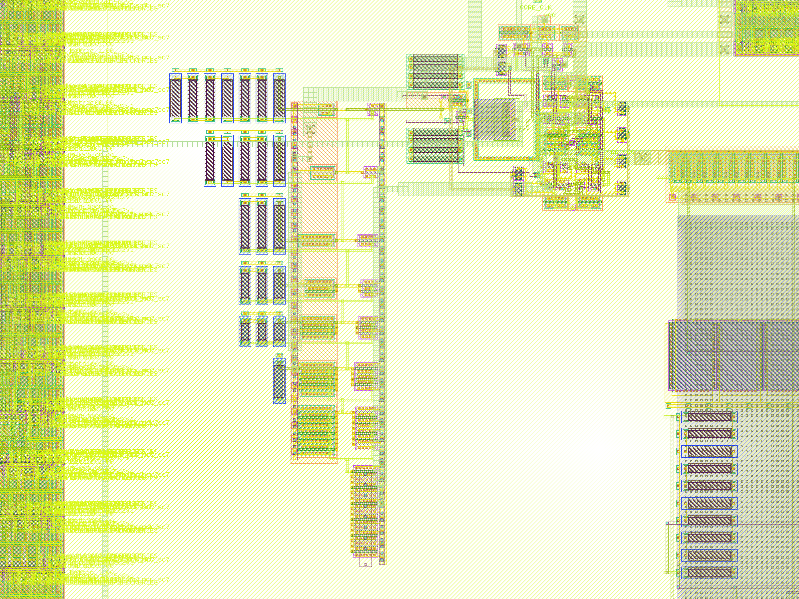
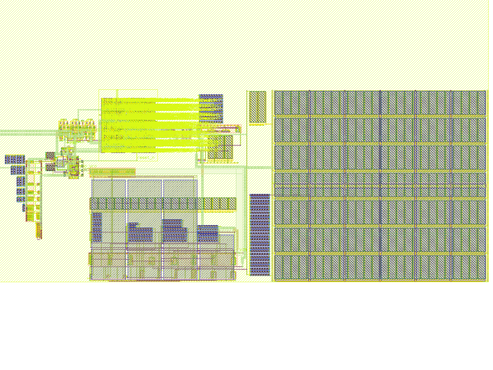
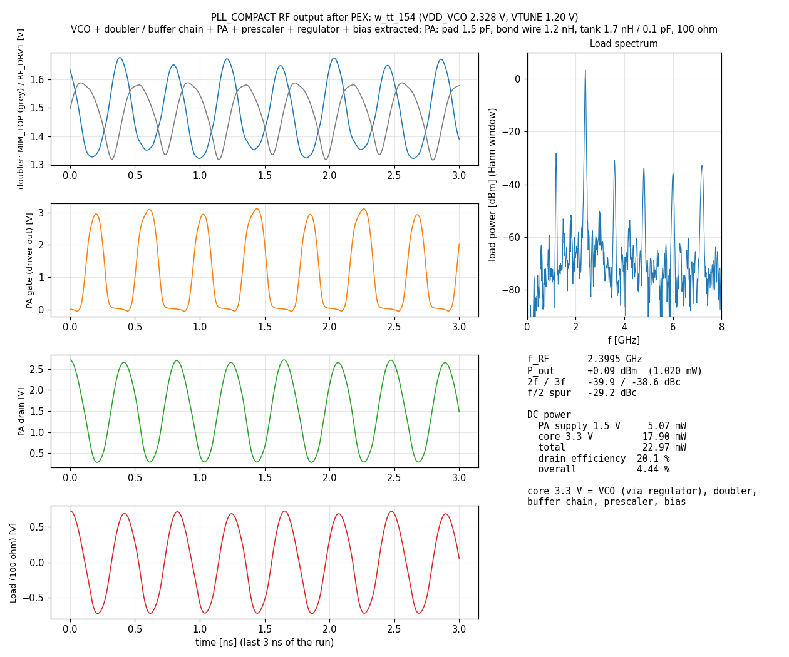
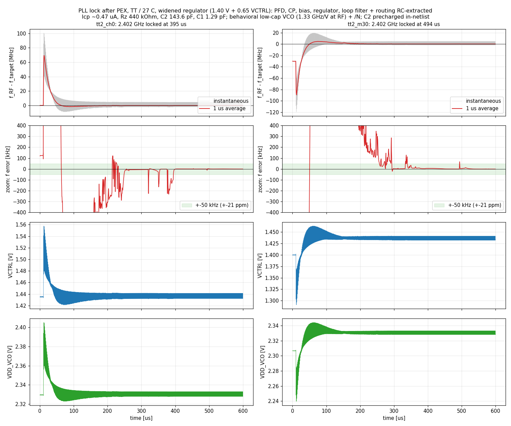

# E03: integrated BLE PLL / TX layout (GF180MCU, 6-metal E stack)

The tapeout GDS is `gds/E03.gds`, top cell `E03` (Chipathon 2026, team E03). It integrates:

- the low-cap Schottky-doubler VCO (`macros/vco_lowcap/`), without its doubler's 2nd / 3rd output inverters;
- `RF_CHAIN_PA`: a graded, self-biased 7-inverter buffer chain and the 50 µm class-C PA device;
- the A01 32/33 prescaler, integer-N divider, PFD and charge pump;
- the 3.3 V VCO supply regulator, re-ratioed to VDD_VCO = 1.40 V + 0.65·VCTRL;
- the A01 loop filter in stacked form (440 kΩ, 143.6 pF, 1.29 pF);
- an on-chip bias block (~0.47 µA charge-pump current at TT, ~1.69 V TAIL_BIAS);
- the `ble_tx_uart` digital block.

Inside the build scripts the top cell is still called `PLL_COMPACT`; `layout/export_e03.py` renames it for the
tapeout (below). The first integration (`A01_topcell`) is commit f8b50d8; the XOR-doubler version of this
integration (`PLL_COMPACT` with the v3 VCO and the RF_CONV_PA converter) is commit b418248.


## Tapeout naming (team E03)

| Item | Name |
|---|---|
| GDS file / top cell | `gds/E03.gds` / `E03` |
| Root `lvs_config.json` | `TOP_SOURCE` `E03`, `LAYOUT_FILE` `$UPRJ_ROOT/build/gds/$TOP_LAYOUT.gds` |
| Other cells | `E03_` + the build name (e.g. `E03_VCO_REG_L`, `E03_via_dev$10`). Generic PDK cell names (`pfet`, `nfet$2`, `via_dev`, `TAP_SUB`, …) would otherwise collide with other projects' cells when the shuttle merges the GDS files. The standard cells (`gf180mcu_fd_sc_mcu7t5v0__*`) keep their library names. |
| LVS reference | `spice/E03_lvs.spice` (top) and `spice/macros/E03_<cell>.spice`, one subckt per macro cell, named like the cell |
| Boundary | `PR_bndry` (0/0) rectangle on the top-level bounding box |

The top-level pins carry the `info.yaml` names and case. Each pin label has a small top-cell pad on its layer so
that it attaches in a hierarchical extraction too.

| info.yaml pin | Design net |
|---|---|
| `vdd` | VDD (3.3 V) |
| `vss` | VSS |
| `reset_n` | RST_N (divider and digital reset) |
| `clk` | CLK_8M (digital clock) |
| `Tx` | UART_RX (packet input of `ble_tx_uart`) |
| `ANT` | PA_DRAIN (PA drain; the 1.5 V PA supply and the tank are off-chip) |

## Files in this folder

| Path | Contents |
|---|---|
| `gds/E03.gds` | Tapeout GDS (self-contained) |
| `spice/` | LVS reference used by the root `lvs_config.json` |
| `layout/` | Build, route, check and export scripts and the new cells' netlists. `export_e03.py` writes `tapeout_e03/` (GDS, reference, `lvs_config.json`) and with `check` runs the LVS below |
| `layout/vco_lc/` | Builds the VCO copy from `macros/vco_lowcap/` and its LVS reference |
| `macros/vco_lowcap/` | The delivered low-cap VCO (`Differential_VCO_low_cap.gds`) and its README |
| `verification/` | `E03_drc_main.lyrdb` (full GF180 DRC, variant E: 0) and `E03_lvs.report` |
| `pex/` | RC extractions: `RF_PART` (VCO, chain + PA, prescaler, regulator, bias + routing) and `LOOP_PART` (PFD, CP, bias, regulator, loop filter + routing) |
| `sim/` | `tx/` RF output, `lock/` post-PEX lock, `regwide/` regulator re-ratio and loop sizing, `lowcap/` buffer-chain study, `retune/` the earlier loop retune |
| `doc/` | Layout renders |
| `bias_study/`, `reg_study/` | Bias and regulator sizing studies |
| `assemble_layout.py`, `design.py`, `tech/` | Kept from the A01 flow: `route_top.py` uses its `Router`, the extraction uses the six-metal tech |

The scripts ran in the IIC-OSIC-TOOLS container with absolute paths: this repository at
`/foss/designs/pll_integration_repo`, the design folder at `/foss/designs/pll_compact` (= this folder's `layout/`,
`sim/`, …), and the delivered VCO at `/foss/designs/Diff_VCO_Second_Layout/low_cap_vco_20261122/delivery`
(= `macros/vco_lowcap/`).

## Floorplan

Coordinates in µm, VCO at the origin; the chip is 706 × 306 µm.



| Block | Place | Size |
|---|---|---|
| low-cap VCO (`E03_Differential_VCO_LC`) | origin | 34 × 29 |
| `E03_RF_CHAIN_PA` (rotated, PA end south) | west of the VCO, x −60.6 … −28.0 | 33 × 75 |
| 32/33 prescaler (mirrored in y) | on top of the VCO | 33 × 22 |
| integer-N divider (mirrored in x) | right of the prescaler | 52 × 63 |
| PFD (mirrored) + charge pump | right of the divider | 13 × 8, 9 × 11 |
| `E03_PLL_BIAS` | right of the charge pump | 40 × 61 |
| `E03_VCO_REG_L` | right of the VCO, under the divider | 138 × 101 |
| `E03_PLL_LF_L` | right of the regulator | 213 × 170 |
| `ble_tx_uart` | x −340 … −70 | 270 × 300 |

| Link | Route |
|---|---|
| RF_DRV1 (doubler → chain stage 1) | 14 µm straight M3 |
| CORE_CLK (VCO → prescaler) | ~12 µm MetalTop from the VCO's CORE_CLK bar |
| VDD_VCO (regulator → VCO) | M5 from the regulator, then MetalTop over the VCO's VTUNE M5 ring, 2.2 µm wide |
| MC / FB_1M / UPB / DN / CP_IBIAS | 27 / 4 / 24 / 22 / 17 µm |



## Cells

| Cell | What | Size (µm) |
|---|---|---|
| `E03_Differential_VCO_LC` | Delivered low-cap VCO minus the doubler's 2nd / 3rd output inverters (2/1 µm; they cannot drive any load), and without the stray `P` / `N` / `B` test labels (`N` sat on both RF_DRV1 and VSS) | 34 × 29 |
| `E03_RF_CHAIN_PA` | RF_DRV1 → 1/2 µm (Rf 40k) → 1.6/3.2 (30k) → 2.5/5 (20k) → 4/8 (12k) → 7/14 (8k) → 12/24 (5k) → 20/40 → 50 µm PA (16 × 3.125 µm). Each early stage sits at its trip point through a ppolyf_u_1k feedback resistor right above it; compact hand placement keeps the extracted node caps at 1.9–6.1 fF (a routed version had 6–10 fF and failed). M4 straps over both rails | 75 × 33 |
| `E03_VCO_REG_L` | Pass PMOS 192 µm, error amplifier, NMOS-input VCTRL buffer; RSETIN / RSETHI / RSETLO 66.9 k / 102.6 k / 47 k (VOUT = 1.40 V + 0.65·VCTRL, ceiling ~3.26 V); RZERO 6.8 k | 138 × 101 |
| `E03_PLL_BIAS` | Resistor-referenced PMOS mirror; CP bias through 2 × 1.04/5 µm in series: 0.39 / 0.47 / 0.57 µA (SS / TT / FF); TAIL_BIAS 1.69 V at TT | 40 × 61 |
| `E03_PLL_LF_L` | Rz 440 kΩ; C2 = 54 pF MIM + ~89 pF `cap_nmos` (the MOS part fades below ~0.7 V); C1 1.29 pF MOS | 213 × 170 |
| A01 macros, `ble_tx_uart` | Unchanged signed-off GDS | |

## Verification

| Check | Result |
|---|---|
| DRC (GF180 KLayout deck, variant E, `E03.gds`) | 0 violations |
| LVS (`export_e03.py check`: flat magic extraction of `E03.gds` vs `spice/`) | Circuits match uniquely, 22,902 devices, 12,522 nets |
| Connectivity (`conncheck.py`, 15 nets, 54 probes) | 0 problems |
| Cells (VCO copy, chain, regulator, bias) | DRC 0, LVS match uniquely each |
| Substrate-only ground islands (`tapcheck.py`) | Only the feedback resistors' body-tap rails and two islands already present before |

## Post-layout results

Regulator re-ratio (`sim/regwide/`, schematic of the laid-out cell):

- VOUT = 1.40 V + 0.65·VCTRL within ±0.05 V / ±0.03 at TT, SS/125, FF/−40, SS/−40, FF/125; 0 dB peaking over
  VCTRL 0.6–2.8 V at all five (RZERO 2.2 k gave 11 dB at TT once the pass device left dropout).
- Channel 0 at VTUNE 1.2 V: FF/−40 ~1.83 V (VCTRL ~0.65), TT ~2.33 V (1.435), SS/125 ~3.19 V (2.75).
- Loop (filter unchanged): SS/125 fc 5.7 kHz PM 49–52°, TT fc 11.5 kHz PM ~74°, FF/−40 fc 23.7 kHz PM 78°.

RF output (`sim/tx/`, VCO + chain + PA + prescaler + regulator + bias extracted; pad 1.5 pF, bond wire 1.2 nH, tank
1.7 nH / 0.1 pF, 100 Ω; VTUNE 1.2 V):

| Corner | f_RF | P_out | f/2 | drain eff. | 3.3 V |
|---|---|---|---|---|---|
| TT/27 | 2.3995 GHz (ch 0) | +0.09 dBm | −29.2 dBc | 20 % | 17.9 mW |
| TT/27 | 2.4687 GHz | +0.61 dBm | −26.7 dBc | 23 % | 18.1 mW |
| SS/125 | 2.4104 GHz | −44.3 dBm (PA gate does not toggle) | −23.9 dBc | – | 13.5 mW |



TT lock (`sim/lock/`, extracted loop partition, behavioral VCO from the extracted TT runs): both starts (at
channel 0, and 30 MHz low) settle without cycle slips, within ±1 MHz in ~45–60 µs and to −1 kHz at 600 µs;
VCTRL 1.435 V, VDD_VCO 2.3295 V. `lock.py` precharges the loop-filter C2 inside a private copy of the
extracted netlist: the DC operating point does not set it (`cap_nmos` model), and without that every run started
with C2 near 0.5 V.



## Open issues

1. **Reference spur at TT / FF.** At lock VCTRL carries 9 mV p-p of 1 MHz CP ripple; at TT the regulator passes it
   (MHz bandwidth, 0.65 V/V), so VDD_VCO has 5 mV p-p and the ±1 MHz spurs are about +10 dBc (±2 MHz −10 dBc,
   ±3 MHz −20 dBc). Needs a VCTRL post-filter ahead of the regulator (≥ ~33 dB at 1 MHz) or a tri-state PFD.
2. **No RF output at SS/125.** The doubled signal at RF_DRV1 is ~0.3 V and the chain lacks gain at 2.4 GHz there.
   Higher-gain stages lock onto f/2, because the doubler output already carries the ring fundamental at −23 dBc.
   Balancing the doubler is the clean fix.
3. **The A01 PFD has no frequency detection.** Acquisition is pull-in through phase slips.
4. **Not connected to pads yet:** REF_1M (1 MHz reference), VTUNE (the GFSK DAC is not integrated; FINE_CODE[7:0]
   and CODE_VALID leave `ble_tx_uart` unused), CFG[5:0] (channel select). Only the six `info.yaml` pins are pins.
5. SS/125 channels 35–39 need more than the ~3.26 V regulator ceiling at VTUNE 1.2 V (a lower VTUNE bias helps).
6. The regulator's start-up from a low VDD_VCO slews for a few hundred ns at TT (slow gate pull-up).

## Rebuild

From `layout/` (as `/foss/designs/pll_compact/layout`) in the container:

```
cd vco_lc && python3 build_vco_lc.py && python3 make_ref.py && cd ..
python3 build_reg.py; python3 build_lf.py; python3 build_bias.py; python3 build_chain_c.py
python3 route_top.py            # placement (build_top.py) + routing -> PLL_COMPACT.gds
python3 conncheck.py; python3 tapcheck.py PLL_COMPACT.gds PLL_COMPACT 3 -3.74 -6.34
python3 lvs_top.py; bash drc.sh PLL_COMPACT.gds PLL_COMPACT drc_top
python3 export_e03.py check     # tapeout_e03/: gds/E03.gds, spice/, lvs_config.json + LVS
python3 extract_rf.py
PEX_LOOP=1 PEX_OUT=pex_loop PEX_CELL=LOOP_PART PEX_KEEP=pfd,pump,bias,reg,lf python3 extract_rf.py
cd ../sim/tx && python3 gen_deck_tx.py w_tt tt27 1.54 1.2 220 full   # then ngspice in w_tt/, python3 measure.py
cd ../lock && CORNER=tt27 VCO=1.199765e9,2.3276,0.664e9 RVCO=2700 python3 lock.py tt2_ch0 600 1.435
```
