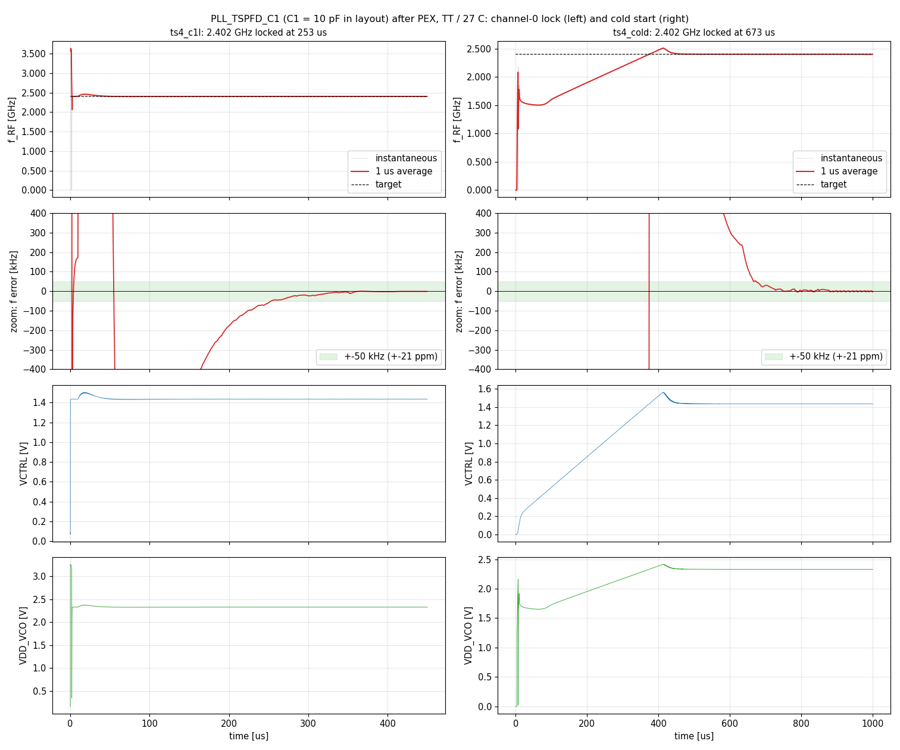
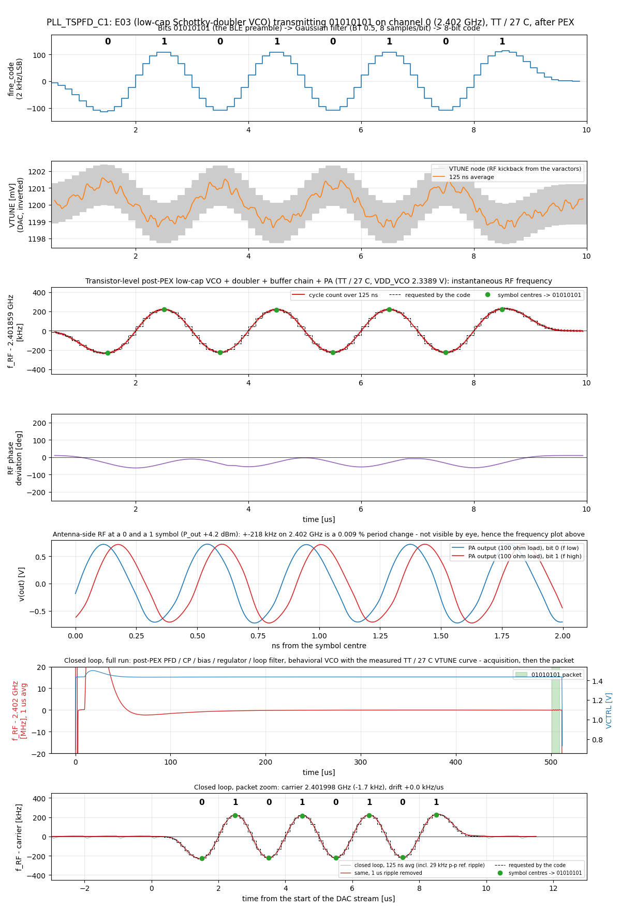
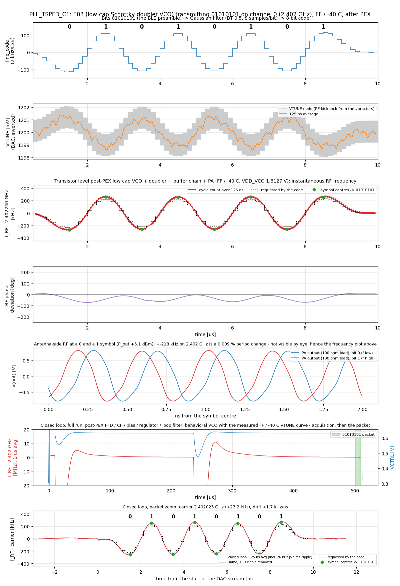

# E03: integrated BLE PLL / TX layout (GF180MCU, 6-metal E stack)

The tapeout GDS is `gds/E03.gds`, top cell `E03` (Chipathon 2026, team E03). It integrates:

- the low-cap Schottky-doubler VCO (`macros/vco_lowcap/`), without its doubler's 2nd / 3rd output inverters;
- `RF_CHAIN_PA`: a graded, self-biased 7-inverter buffer chain and the 50 µm class-C PA device;
- the A01 32/33 prescaler, integer-N divider and charge pump;
- `TS_PFD`: a three-state PFD with frequency detection (Centurelli et al., "Robust three-state PFD architecture with
  enhanced frequency acquisition capabilities", Fig. 4), assembled from the team's TSPC flip-flop and gate cells
  (`macros/ts_pfd/`); it replaces the A01 PFD;
- the 3.3 V VCO supply regulator, re-ratioed to VDD_VCO = 1.40 V + 0.65·VCTRL;
- `PLL_LF_L10`: the stacked loop filter (440 kΩ, 143.6 pF) with C1 raised from 1.29 pF to 10.0 pF (1.29 pF MOS +
  8.71 pF in six MIM plates on top of the filter);
- an on-chip bias block (~0.47 µA charge-pump current at TT, ~1.69 V TAIL_BIAS);
- the `ble_tx_uart` digital block.

Inside the build scripts the top cell is `PLL_TSPFD_C1` (`PFD_VARIANT=ts LF_VARIANT=c10`; without the variables
they still build `PLL_COMPACT`, the A01-PFD / 1.29 pF version); `layout/export_e03.py` renames it for the tapeout
(below). The A01-PFD E03 export is commit ac855a7, the first integration (`A01_topcell`) is commit f8b50d8, and the
XOR-doubler version of this integration (`PLL_COMPACT` with the v3 VCO and the RF_CONV_PA converter) is commit
b418248.


## Tapeout naming (team E03)

| Item | Name |
|---|---|
| GDS file / top cell | `gds/E03.gds` / `E03` |
| Root `lvs_config.json` | `TOP_SOURCE` `E03`, `LAYOUT_FILE` `$UPRJ_ROOT/build/gds/$TOP_LAYOUT.gds` |
| Other cells | `E03_` + the build name (e.g. `E03_VCO_REG_L`, `E03_via_dev$10`). Generic PDK cell names (`pfet`, `nfet$2`, `via_dev`, `TAP_SUB`, …) would otherwise collide with other projects' cells when the shuttle merges the GDS files. The standard cells (`gf180mcu_fd_sc_mcu7t5v0__*`) keep their library names. |
| LVS reference | `spice/E03_lvs.spice` (top) and `spice/macros/E03_<cell>.spice`, one subckt per macro cell, named like the cell |
| Boundary | `PR_bndry` (0/0) rectangle on the top-level bounding box |

The top-level pins carry the `info.yaml` names and case. Each pin label has a small top-cell pad on its layer so
that it attaches in a hierarchical extraction too.

| info.yaml pin | Design net |
|---|---|
| `vdd` | VDD (3.3 V) |
| `vss` | VSS |
| `reset_n` | RST_N (divider and digital reset) |
| `clk` | CLK_8M (digital clock) |
| `Tx` | UART_RX (packet input of `ble_tx_uart`) |
| `ANT` | PA_DRAIN (PA drain; the 1.5 V PA supply and the tank are off-chip) |

## Files in this folder

| Path | Contents |
|---|---|
| `gds/E03.gds` | Tapeout GDS (self-contained) |
| `spice/` | LVS reference used by the root `lvs_config.json` |
| `layout/` | Build, route, check and export scripts and the new cells' netlists. `export_e03.py` writes `tapeout_e03_tsc1/` (GDS, reference, `lvs_config.json`) and with `check` runs the LVS below. `build_lf10.py` adds the C1 plates (`PLL_LF_L10`) |
| `layout/vco_lc/` | Builds the VCO copy from `macros/vco_lowcap/` and its LVS reference |
| `macros/vco_lowcap/` | The delivered low-cap VCO (`Differential_VCO_low_cap.gds`) and its README |
| `macros/ts_pfd/` | `TS_PFD.gds` and the five TSPC / gate cells it is built from (`*_fixed.gds`: DRC-clean, labelled copies of the team's cells), their LVS references (`cells/ref_*.spice`, `ref_pfd.spice`) and the fix scripts (`cells/fix_*.py`) |
| `pfd/` | `build_pfd.py` (places and routes `TS_PFD` from the cells), its DRC / LVS results and RC extraction (`TS_PFD_rcpex.spice`), and the post-PEX PFD and PFD + charge-pump tests (`pfd/sim/`) |
| `verification/` | `E03_drc_main.lyrdb` (full GF180 DRC, variant E: 0) and `E03_lvs.report` |
| `pex/` | RC extractions: `RF_PART` (VCO, chain + PA, prescaler, regulator, bias + routing), `LOOP_PART` (TS_PFD, CP, bias, regulator, loop filter with C1 10 pF + routing), `VCO_LC_PRESCALER` (VCO + prescaler, the transmit decks' RF source) and `RF_CHAIN_PA` |
| `sim/` | `tx_tt/` full-chip transmit and class-C PA at TT and FF, `lock/` post-PEX lock and spurs, `tx/` the earlier RF output and the GFSK stimulus (`gfsk.py`), `regwide/` regulator re-ratio and loop sizing, `lowcap/` buffer-chain study, `retune/` the earlier loop retune |
| `doc/` | Layout renders |
| `bias_study/`, `reg_study/` | Bias and regulator sizing studies |
| `assemble_layout.py`, `design.py`, `tech/` | Kept from the A01 flow: `route_top.py` uses its `Router`, the extraction uses the six-metal tech |

The scripts ran in the IIC-OSIC-TOOLS container with absolute paths: this repository at
`/foss/designs/pll_integration_repo`, the design folder at `/foss/designs/pll_compact` (= this folder's `layout/`,
`sim/`, …), and the delivered VCO at `/foss/designs/Diff_VCO_Second_Layout/low_cap_vco_20261122/delivery`
(= `macros/vco_lowcap/`). The TS_PFD cells sat in `/foss/designs/Tri_State_Phase_Detector` (= `macros/ts_pfd/`,
the cell references and fix scripts in `/foss/designs/pll_compact/tspc_check` = `macros/ts_pfd/cells/`). The
transmit decks include `/foss/designs/pll_compact/sim/lowcap/ctt/net.spice` (= `pex/VCO_LC_PRESCALER_rcpex.spice`)
and `layout/pex_chainc/RF_CHAIN_PA_rcpex.spice` (= `pex/RF_CHAIN_PA_rcpex.spice`).

## Floorplan

Coordinates in µm, VCO at the origin; the chip is 706 × 306 µm.


| Block | Place | Size |
|---|---|---|
| low-cap VCO (`E03_Differential_VCO_LC`) | origin | 34 × 29 |
| `E03_RF_CHAIN_PA` (rotated, PA end south) | west of the VCO, x −60.6 … −28.0 | 33 × 75 |
| 32/33 prescaler (mirrored in y) | on top of the VCO | 33 × 22 |
| integer-N divider (mirrored in x) | right of the prescaler | 52 × 63 |
| charge pump | right of the divider | 9 × 11 |
| `E03_TS_PFD` | above the divider and bias, x 76.0 … 156.3, y 72.0 … 104.7 | 80 × 33 |
| `E03_PLL_BIAS` | right of the charge pump | 40 × 61 |
| `E03_VCO_REG_L` | right of the VCO, under the divider | 138 × 101 |
| `E03_PLL_LF_L10` | right of the regulator, x 152.4 … 366.0 | 214 × 198 |
| `ble_tx_uart` | x −340 … −70 | 270 × 300 |

| Link | Route |
|---|---|
| RF_DRV1 (doubler → chain stage 1) | 14 µm straight M3 |
| CORE_CLK (VCO → prescaler) | ~12 µm MetalTop from the VCO's CORE_CLK bar |
| VDD_VCO (regulator → VCO) | M5 from the regulator, then MetalTop over the VCO's VTUNE M5 ring, 2.2 µm wide |
| MC / CP_IBIAS | 27 / 17 µm |
| REF_1M / FB_1M / UPB / DN / VDD / VSS to `E03_TS_PFD` | grid-routed on M5 / MetalTop to the PFD's boundary ports on its south edge (`route_top.py`, `TS_LAND`) |


## Cells

| Cell | What | Size (µm) |
|---|---|---|
| `E03_Differential_VCO_LC` | Delivered low-cap VCO minus the doubler's 2nd / 3rd output inverters (2/1 µm; they cannot drive any load), and without the stray `P` / `N` / `B` test labels (`N` sat on both RF_DRV1 and VSS) | 34 × 29 |
| `E03_RF_CHAIN_PA` | RF_DRV1 → 1/2 µm (Rf 40k) → 1.6/3.2 (30k) → 2.5/5 (20k) → 4/8 (12k) → 7/14 (8k) → 12/24 (5k) → 20/40 → 50 µm PA (16 × 3.125 µm). Each early stage sits at its trip point through a ppolyf_u_1k feedback resistor right above it; compact hand placement keeps the extracted node caps at 1.9–6.1 fF (a routed version had 6–10 fF and failed). M4 straps over both rails | 75 × 33 |
| `E03_VCO_REG_L` | Pass PMOS 192 µm, error amplifier, NMOS-input VCTRL buffer; RSETIN / RSETHI / RSETLO 66.9 k / 102.6 k / 47 k (VOUT = 1.40 V + 0.65·VCTRL, ceiling ~3.26 V); RZERO 6.8 k | 138 × 101 |
| `E03_PLL_BIAS` | Resistor-referenced PMOS mirror; CP bias through 2 × 1.04/5 µm in series: 0.39 / 0.47 / 0.57 µA (SS / TT / FF); TAIL_BIAS 1.69 V at TT | 40 × 61 |
| `E03_PLL_LF_L10` | Rz 440 kΩ; C2 = 54 pF MIM + ~89 pF `cap_nmos` (the MOS part fades below ~0.7 V); C1 = 1.29 pF MOS + 6 × `cap_mim_2f0_m5m6_noshield` 28.16 × 25.45 µm (8.71 pF) in a new row on top = 10.0 pF | 214 × 198 |
| `E03_TS_PFD` | Three-state PFD (Centurelli Fig. 4): SR and R TSPC flip-flops, 2-input AND, AND with one inverted input, OR (cells `E03_SR_FlipFlop`, `E03_R_FlipFlop`, `E03_2_Input_And`, `E03_2_Input_And_Inv_Input`, `E03_2_Input_Or`); inputs R (REF_1M) and V (FB_1M), outputs UPB / DN to the A01 charge pump | 80 × 33 |
| A01 macros, `ble_tx_uart` | Unchanged signed-off GDS | |

## Verification

| Check | Result |
|---|---|
| DRC (GF180 KLayout deck, variant E, `E03.gds`) | 0 violations |
| LVS (`export_e03.py check`: flat magic extraction of `E03.gds` vs `spice/`) | Circuits match uniquely, 23,002 devices, 12,573 nets |
| Build top `PLL_TSPFD_C1` (`drc.sh`, `lvs_top.py`) | DRC 0; LVS match uniquely, 23,002 devices |
| Connectivity (`conncheck.py`, 15 nets, 54 probes) | 0 problems on the A01-PFD `PLL_COMPACT` (the script probes the A01 PFD pins; for `PLL_TSPFD_C1` the flat LVS above covers the connectivity) |
| Cells (VCO copy, chain, regulator, bias, `PLL_LF_L10`, `TS_PFD`) | DRC 0, LVS match uniquely each |
| TSPC / gate cells (`macros/ts_pfd/*_fixed.gds`) | DRC 0, LVS match uniquely each |
| Substrate-only ground islands (`tapcheck.py`) | Only the feedback resistors' body-tap rails and two islands already present before |

## Post-layout results: TS_PFD + C1 10 pF (this tapeout)

Loop partition `pex/LOOP_PART_rcpex.spice` (TS_PFD, charge pump, bias, regulator, `PLL_LF_L10` and all routing,
RC-extracted from `PLL_TSPFD_C1`). The closed-loop runs need `tran` tmax 0.5 ns for the TSPC PFD. At that step the
PDK `cap_nmos` C(V) model aborts, so the runs use `LOOP_PART_rcpex_ff_lin.spice`: floating extraction pieces tied to
VSS through 1 TΩ (`sim/lock/floatfix.py`) and the MOS caps as linear capacitors at their inversion value
(`sim/lock/linmoscap.py`). `RSHUNT=1e15`: the old `rshunt=1e12` with `uic` put a fake ~1.4 nA leak on the
969-node C2 net, which dominated the spur.

**Lock and spurs, TT/27** (`sim/lock/`, behavioral VCO from the extracted TT runs, `lock_tsc1*.png`):

| Run | Result |
|---|---|
| Channel 0 (`ts4_c1l`, C2 precharged) | within ±50 kHz from 253 µs; −0.9 kHz mean over the last 30 µs; VCTRL 1.435 V, VDD_VCO 2.3295 V |
| Cold start (`ts4_cold`, VDD 0 → 3.3 V in 10 µs, no precharge) | within ±50 kHz from 673 µs |
| Reference spurs (last 150 µs of `ts4_c1l`) | ±1 MHz −46 dBc, ±2 MHz −56 dBc, ±3 MHz −63 dBc (C1 1.29 pF: −28 / −39 / −45 dBc) |
| Phase margin, C1 10 pF | TT 61°, SS/125 42°, FF/−40 55° (C1 1.29 pF: 75° / 49° / 78°) |



**Transmit, TT/27 and FF/−40** (`sim/tx_tt/`). The closed loop uses the post-PEX loop partition, a behavioral VCO
anchored on the corner's transistor-level runs (FF: ring 1.2395 GHz at 1.85 V, 1.020 GHz/V; RVCO 2990 Ω) and the
corner's measured VTUNE curve. It locks, then sends 01010101 from 500 µs. The RF windows are transistor level after
PEX: VCO + doubler, prescaler, buffer chain and the on-chip 50 µm PA NMOS, with VDD_VCO and TAIL_BIAS at the corner's
lock values (TT 2.3389 V / 1.686 V, FF 1.8127 V / 1.514 V). The PA drives pad 1.5 pF → bond wire 1.2 nH → off-chip
tank 1.70 nH to VPA 1.5 V ∥ 0.1 pF → 20 pF DC block → 100 Ω.

| | TT/27 | FF/−40 |
|---|---|---|
| RF windows: carrier (VTUNE 1.2 V, open loop) | 2.401859 GHz (−0.14 MHz) | 2.402240 GHz (+0.24 MHz) |
| RF windows: deviation at the symbol centres (0101) | −231 … +222 kHz | −271 … +261 kHz |
| RF windows: peak deviation | +238 / −240 kHz | +284 / −285 kHz |
| RF windows: demodulated | 01010101, correct | 01010101, correct |
| RF windows: P_out | +4.19 dBm | +5.14 dBm |
| Closed loop: carrier during the packet | 2.401998 GHz (−1.7 kHz), drift +0.01 kHz/µs | 2.402023 GHz (+23 kHz), drift +1.75 kHz/µs (still settling after the slip below) |
| Closed loop: demodulated | 01010101, correct | 01010101, correct |
| Closed loop: 1 MHz reference ripple on f_RF | 29 kHz p-p | 26 kHz p-p |
| Closed loop: cycle slips after acquisition (`slips.sh`) | none in 487 cycles | one, at 237 µs (back within 0.1 MHz by ~450 µs); open issue 3 |





**Class-C PA** (`sim/tx_tt/pa.py`, VTUNE 1.2 V, last 200 ns of a 300 ns run; LPF = off-chip 5th-order 0.1 dB
Chebyshev low-pass, 100 Ω, 2.6 GHz edge, ideal L / C: 0.702 pF, 8.39 nH, 1.209 pF, 8.39 nH, 0.702 pF):

| Corner | Filter | f_RF | P_out | H2 | H3 | Drain swing | I_PA (1.5 V) | η_drain | 3.3 V: chain + VCO/prescaler VDD | VDD_VCO current |
|---|---|---|---|---|---|---|---|---|---|---|
| TT/27 | none | 2.40186 GHz | +4.16 dBm | −46.1 dBc | −29.5 dBc | 0.28–2.72 V | 3.68 mA | 47 % | 4.77 mA | 0.81 mA |
| TT/27 | LPF | 2.40185 GHz | +4.19 dBm | −69.2 dBc | −59.1 dBc | 0.30–2.70 V | 3.81 mA | 46 % | 4.76 mA | 0.81 mA |
| FF/−40 | none | 2.40224 GHz | +5.09 dBm | −25.2 dBc | −24.8 dBc | 0.17–2.88 V | 4.93 mA | 44 % | 5.38 mA | 0.61 mA |
| FF/−40 | LPF | 2.40225 GHz | +5.12 dBm | −54.2 dBc | −54.0 dBc | 0.16–2.88 V | 5.11 mA | 42 % | 5.39 mA | 0.61 mA |

Without a filter the harmonics fail the spurious limits: TT H3 is −25 dBm, and FF H2 and H3 are about −20 dBm,
against −30 dBm (ETSI EN 300 328) and −41 dBm (FCC restricted bands, which include H2 at 4.80–4.96 GHz). With the LPF
the worst harmonic is −49 dBm (FF), so the board needs that filter (or an equivalent matching network). The drain peak
stays below 2.9 V.

**3.3 V budget.** The loop partition draws 1.50 mA at TT (VCO load 0.86 mA, the rest regulator, bias, PFD and
charge pump) and 1.53 mA at FF (`sim/tx_tt/biasop.py`). With the RF chain and prescaler, the 3.3 V pin draws about
6.2 mA at TT and 6.8 mA at FF, plus the digital block. That is above the ~5 mA the 3.3 V line can supply. The buffer
chain is the largest share (4.3 mA TT, 4.8 mA FF; the VCO / prescaler block's VDD takes 0.5–0.6 mA). The PA's own 1.5 V supply (3.7–5.1 mA) is
off-chip.

## Earlier post-layout results (A01 PFD, C1 1.29 pF; commit ac855a7)

Regulator re-ratio (`sim/regwide/`, schematic of the laid-out cell):

- VOUT = 1.40 V + 0.65·VCTRL within ±0.05 V / ±0.03 at TT, SS/125, FF/−40, SS/−40, FF/125; 0 dB peaking over
  VCTRL 0.6–2.8 V at all five (RZERO 2.2 k gave 11 dB at TT once the pass device left dropout).
- Channel 0 at VTUNE 1.2 V: FF/−40 ~1.83 V (VCTRL ~0.65), TT ~2.33 V (1.435), SS/125 ~3.19 V (2.75).
- Loop (filter unchanged): SS/125 fc 5.7 kHz PM 49–52°, TT fc 11.5 kHz PM ~74°, FF/−40 fc 23.7 kHz PM 78°.

RF output (`sim/tx/`, VCO + chain + PA + prescaler + regulator + bias extracted; pad 1.5 pF, bond wire 1.2 nH, tank
1.7 nH / 0.1 pF, 100 Ω; VTUNE 1.2 V):

| Corner | f_RF | P_out | f/2 | drain eff. | 3.3 V |
|---|---|---|---|---|---|
| TT/27 | 2.3995 GHz (ch 0) | +0.09 dBm | −29.2 dBc | 20 % | 17.9 mW |
| TT/27 | 2.4687 GHz | +0.61 dBm | −26.7 dBc | 23 % | 18.1 mW |
| SS/125 | 2.4104 GHz | −44.3 dBm (PA gate does not toggle) | −23.9 dBc | – | 13.5 mW |


TT lock (`sim/lock/`, extracted loop partition, behavioral VCO from the extracted TT runs): both starts (at
channel 0, and 30 MHz low) settle without cycle slips, within ±1 MHz in ~45–60 µs and to −1 kHz at 600 µs;
VCTRL 1.435 V, VDD_VCO 2.3295 V. `lock.py` precharges the loop-filter C2 inside a private copy of the
extracted netlist: the DC operating point does not set it (`cap_nmos` model), and without that every run started
with C2 near 0.5 V.


## Open issues

1. **3.3 V current.** About 6.2 mA at TT and 6.8 mA at FF (above), against the ~5 mA the 3.3 V line supplies. The
   buffer chain (4.3–4.8 mA) is the place to save.
2. **Harmonics need an off-chip low-pass.** Without it, H2 / H3 are at −20 to −25 dBm. The 5th-order LPF above gives
   ≤ −49 dBm with ideal parts; check it with real component Q and the board layout.
3. **One cycle slip in the FF closed loop, cause not settled.** At 237 µs, while locked, DN re-asserted 0.8 ns after
   a reset with no new feedback edge.
   - Effect: the loop slipped one reference cycle (f_RF dipped by 190 MHz) and was back within 0.1 MHz by ~450 µs. The packet at
     500 µs still decoded, with a residual drift of +1.75 kHz/µs.
   - Not reproduced: the PFD alone gave 0 of 298 cycles (`pfd/sim/race.py`), and the PFD inside the extracted loop
     partition with VCTRL held gave 0 of 148 (`MODE=loop`). Both ran at FF/−40 over the same 1.85–2.15 ns leads with
     the same 0.5 ns step. The TT closed loop had no slip in 487 locked cycles.
   - For a numerical cause: the solver took 128–203 ps steps through that DN edge, against 14–40 ps in the good
     cycles.
   - Against ruling out a real race: the FF reset pulse is 0.47 ns, the shortest of the three corners.
   - Next: rerun the FF loop at tmax 0.25 ns. A longer reset delay in `TS_PFD` would add margin either way.
4. **GFSK deviation depends on the corner.** The DAC codes are scaled for the TT VTUNE slope (−196 MHz/V at RF).
   At FF it is −233 MHz/V, so the deviation is ~19 % high: ~±260 kHz at the symbol centres for 0101, against
   ~±220 kHz at TT. That likely puts the FF 00001111 deviation above BLE's 275 kHz limit. The DAC full scale needs
   a per-chip calibration.
5. **Divider edges into the TSPC PFD.** The real divider output rises in ~1.2 ns at TT and ~2.2 ns at SS; the
   closed-loop runs use 0.3 ns behavioral edges. Input buffers in front of `TS_PFD`'s R and V would make it
   independent of that.
6. **No RF output at SS/125.** The doubled signal at RF_DRV1 is ~0.3 V and the chain lacks gain at 2.4 GHz there.
   Higher-gain stages lock onto f/2, because the doubler output already carries the ring fundamental at −23 dBc.
   Balancing the doubler is the clean fix.
7. **Not connected to pads yet:** REF_1M (1 MHz reference), VTUNE (the GFSK DAC is not integrated; FINE_CODE[7:0]
   and CODE_VALID leave `ble_tx_uart` unused), CFG[5:0] (channel select). Only the six `info.yaml` pins are pins.
8. SS/125 channels 35–39 need more than the ~3.26 V regulator ceiling at VTUNE 1.2 V (a lower VTUNE bias helps).
9. The regulator's start-up from a low VDD_VCO slews for a few hundred ns at TT (slow gate pull-up).

## Rebuild

From `layout/` (as `/foss/designs/pll_compact/layout`) in the container:

```
cd vco_lc && python3 build_vco_lc.py && python3 make_ref.py && cd ..
python3 build_reg.py; python3 build_lf.py; python3 build_bias.py; python3 build_chain_c.py
python3 build_lf10.py           # PLL_LF_L10: PLL_LF_L + the C1 MIM row
cd ../pfd && python3 build_pfd.py && cd ../layout    # TS_PFD.gds from macros/ts_pfd/*_fixed.gds
export PFD_VARIANT=ts LF_VARIANT=c10                 # without these: the A01-PFD PLL_COMPACT
python3 route_top.py            # placement (build_top.py) + routing -> PLL_TSPFD_C1.gds
python3 lvs_top.py; bash drc.sh PLL_TSPFD_C1.gds PLL_TSPFD_C1 drc_tspfd_c1
python3 export_e03.py check     # tapeout_e03_tsc1/: gds/E03.gds, spice/, lvs_config.json + LVS
python3 extract_rf.py
PEX_LOOP=1 PEX_OUT=pex_loop_ts_c1 PEX_CELL=LOOP_PART PEX_KEEP=tspfd,pump,bias,reg,lf python3 extract_rf.py
cd ../sim/lock
P=../../layout/pex_loop_ts_c1/LOOP_PART_rcpex
python3 floatfix.py $P.spice ${P}_ff.spice LOOP_PART && python3 linmoscap.py ${P}_ff.spice ${P}_ff_lin.spice
S="UIC=1 FBSHARP=1000 REFTR=0.3n TMAX=0.5n TSTEP=0.5n RSHUNT=1e15 LOOPNET=$(realpath ${P}_ff_lin.spice)"
V="CORNER=tt27 VCO=1.199765e9,2.3276,0.664e9 RVCO=2700"
env $S $V python3 lock.py ts4_c1l 450 1.435; env $S $V COLD=1 python3 lock.py ts4_cold 1000
python3 plot_lock.py lock_tsc1.png ts4_c1l ts4_cold; python3 spec_tt.py lock_tsc1_spectrum.png ts4_c1l 150
cd ../tx_tt
for i in 0 1 2; do VDDVCO=2.3389 python3 deck_tt.py data_c$i pwl:stim/c$i.pwl 3350 lite; done   # TT RF windows
bash queue_full.sh; bash queue_lpf.sh     # FF RF windows, TT / FF closed loops, PA with the LPF
VDDVCO=2.3389 python3 deck_tt.py pa_tt 1.2 300; CORNER=ff-40 TAIL=1.514 VDDVCO=1.8127 python3 deck_tt.py pa_ff 1.2 300
python3 pa.py pa_tt pa_tt_lpf pa_ff pa_ff_lpf
VDDVCO_TXT=2.3389 python3 plot_tx_tt.py tx_tt_full.png loop_tt_c1l 500
DATA=dataff_c CORNER_TXT="FF / -40 C" VDDVCO_TXT=1.8127 python3 plot_tx_tt.py tx_ff_full.png loop_ff_c1 500
bash slips.sh loop_ff_c1/out.txt 30      # reference cycles with UP / DN on for > 100 ns
```

(`data_c2` ran for 3250 ns.) The earlier A01-PFD flow is the same without `PFD_VARIANT` / `LF_VARIANT`
(`tapeout_e03/`, `pex_loop`, `sim/tx/`, `lock.py tt2_ch0`).
